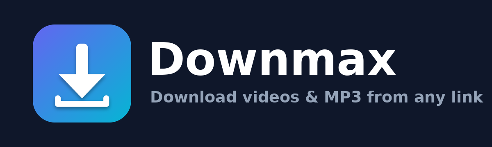

<p align="center"></p>

# Downmax — Video & MP3 Downloader

Downmax ek simple, fast desktop app hai jisse aap **YouTube, Facebook, Instagram** aur
yt-dlp ke 1000+ supported sites se video (MP4) ya audio (MP3) download kar sakte hain.
Agar koi aisa link paste karte hain jo directly supported nahi hai, to Downmax us page ke
andar embedded video dhoondhne ki koshish karta hai.

## Features
- 🎬 Video download — Best, 4K, 2K, 1080p, 720p, 480p, 360p, 240p (MP4)
- 🎵 MP3 download — 128 / 192 / 256 / 320 kbps
- 📋 One-click Paste + link preview (thumbnail, title, duration)
- 📃 Full playlist download (optional)
- 📊 Live progress, speed and ETA, Cancel button
- 🔐 Optional `cookies.txt` for private / login-only videos
- 📦 FFmpeg bundled automatically (via `imageio-ffmpeg`)
- 🖥️ Windows, macOS, Linux

## Run from source
```bash
git clone https://github.com/<your-username>/Downmax.git
cd Downmax
pip install -r requirements.txt
python main.py
```

## Build executable (.exe)
Local:
```bash
pip install pyinstaller
pyinstaller --noconfirm --clean --windowed --onefile --name Downmax \
  --icon assets/icon.ico --add-data "assets;assets" \
  --collect-all customtkinter --collect-all yt_dlp --collect-all imageio_ffmpeg main.py
```
(macOS/Linux par `"assets;assets"` ki jagah `"assets:assets"` use karein.)

GitHub par automatic: ek tag push karein, Actions Windows/macOS/Linux build bana kar Release me daal dega.
```bash
git tag v1.0.0 && git push origin v1.0.0
```

## Tips
- Sites apne format badalti rehti hain. Agar download fail ho, to `pip install -U yt-dlp` karein
  (ya app dobara build karein).
- Instagram/Facebook private posts ke liye browser extension se `cookies.txt` export karke app me "Select" karein.

## Disclaimer
Sirf wahi content download karein jo aapka apna ho ya jiski aapko permission ho. Har platform ke
Terms of Service aur local copyright law ka palan karna user ki zimmedari hai.

## Developer
**TKsadhan** — 📧 [sadhanpatar@gmail.com](mailto:sadhanpatar@gmail.com)

Licensed under the MIT License.
